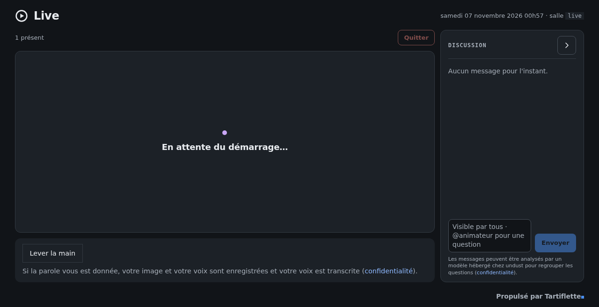

# Live

**Webinaires auto-hébergés sur LiveKit.** Une régie, une prise de parole
soumise à un accord à l'image enregistré, une transcription en direct par
votre propre serveur Whisper, des questions du chat triées par un LLM local.
Rails 8 et SQLite, sur un seul serveur.

[English](README.md)

Le Café IA ([tartiflette.dev](https://tartiflette.dev)) tourne dessus.

## Ce que fait Live

- **Régie** : lancer et terminer le direct, mettre un intervenant en avant,
  couper le micro d'un participant ou le retirer, lancer des sondages affichés
  sur la scène.
- **Prise de parole sous accord** : un spectateur ne publie caméra ou micro
  qu'après avoir accepté l'accord à l'image et reçu la parole. Une seule règle
  du code décide qui peut publier (`PublishPermission`).
- **Le consentement est une preuve** : le libellé est conservé tel qu'il a été
  affiché, avec la version de la politique de confidentialité ; l'accord se
  retire, et une procédure de dépublication suit
  ([docs/depublication.md](docs/depublication.md)). Les inscriptions sont
  purgées au bout de 12 mois.
- **L'IA sur vos machines** : transcription en direct par un worker LiveKit
  Agents ([transcriber/](transcriber/)) vers n'importe quel Whisper compatible
  OpenAI ; file de questions extraite du chat par un LLM local, désactivée par
  défaut.
- **Enregistrement** : une piste par intervenant, assemblées par personne dans
  l'application ; le montage du replay piloté par la parole et les versions
  légères de publication sont rendus par un moteur externe, non distribué avec
  l'application (contrat par fichiers dans [docs/replays.md](docs/replays.md)).
- **Autour du direct** : agenda public et flux iCalendar, API d'inscription
  pour un site statique, rappels la veille, liens intervenants, co-animateurs.

## Démarrer

- **Essayer en local** : [docs/quickstart.md](docs/quickstart.md) lance
  l'application et LiveKit d'un seul `docker compose up`, avec une connexion
  de développement.
- **Mettre en service** : un serveur LiveKit (TURN recommandé), un fournisseur
  OIDC pour les animateurs, un SMTP. En option : Whisper et LLM (compatibles
  OpenAI), Nextcloud pour publier les épisodes.
- **Développer** : `bin/setup`, puis `bin/dev`. Tests : `bin/rails test`,
  `bin/rails test:system`, et `pytest` dans `transcriber/`.

## Limites

- Un seul hôte applicatif : la prise de parole repose sur un verrou fichier par
  webinaire.
- L'interface est d'abord en français ; les commentaires du code aussi.
- Les animateurs se connectent par OIDC ; spectateurs et intervenants entrent
  par des liens.

## Licence

Logiciel libre sous licence publique générale GNU Affero, version 3
uniquement ([AGPL-3.0-only](https://www.gnu.org/licenses/agpl-3.0.html)), avec
des termes additionnels au titre de sa section 7 (attribution, marquage des
versions modifiées, marques) : voir [ADDITIONAL_TERMS.md](ADDITIONAL_TERMS.md).

## Contact

Conçu et maintenu par l'équipe [tartiflette.dev](https://tartiflette.dev).
Questions et accompagnement professionnel : contact@tartiflette.dev.

---

Propulsé par Tartiflette · [tartiflette.dev](https://tartiflette.dev)
