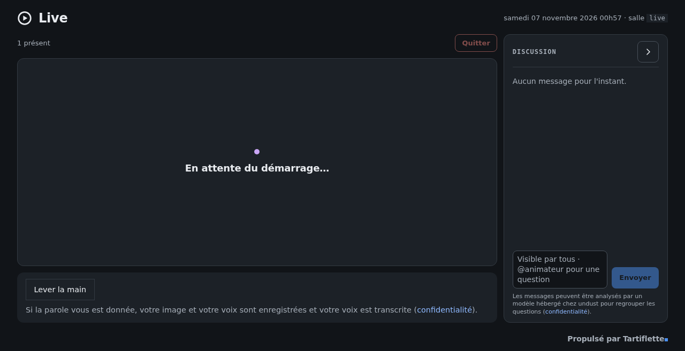

# Live

**Self-hosted webinars on LiveKit.** A host control room, hand raising gated
by a recorded image consent, live transcription with your own Whisper server,
chat questions sorted by a local LLM. Rails 8 and SQLite, on one server.

[Français](README.fr.md)

The Café IA ([tartiflette.dev](https://tartiflette.dev)) runs on it.

## What it does

- **Control room**: start and end the live, spotlight a speaker, mute or
  remove a participant, run polls shown over the stage.
- **Hand raising under consent**: a viewer publishes camera or microphone only
  after accepting the image consent and being given the floor. One rule in the
  code decides who may publish (`PublishPermission`).
- **Consent is evidence**: the wording is stored as it was displayed, with the
  version of the privacy policy; consent can be withdrawn, and an unpublishing
  procedure follows ([docs/depublication.md](docs/depublication.md)).
  Registrations are purged after 12 months.
- **AI on your own machines**: live transcription by a LiveKit Agents worker
  ([transcriber/](transcriber/)) against any OpenAI-compatible Whisper
  endpoint; a question queue extracted from the chat by a local LLM, off by
  default.
- **Recording**: one track per speaker, assembled per person by the app; the
  speech-driven replay edit and the light versions for publishing are rendered
  by an external engine, not distributed with the application (file contract
  in [docs/replays.md](docs/replays.md)).
- **Around the live**: public agenda and iCalendar feeds, a registration API
  for a static site, reminders the day before, speaker links, co-hosts.

## Getting started

- **Try it locally**: [docs/quickstart.md](docs/quickstart.md) runs the app
  and LiveKit with one `docker compose up`, and a development sign-in.
- **Run it for real**: a LiveKit server (TURN recommended), an OIDC provider
  for hosts, SMTP. Optional: Whisper and LLM endpoints (OpenAI-compatible),
  Nextcloud to publish episodes.
- **Develop**: `bin/setup`, then `bin/dev`. Tests: `bin/rails test`,
  `bin/rails test:system`, and `pytest` in `transcriber/`.

## Limits

- One application host: hand raising relies on a file lock per webinar.
- The interface is French-first; code comments are in French.
- Hosts sign in through OIDC; viewers and speakers join with links.

## License

Free software under the GNU Affero General Public License, version 3 only
([AGPL-3.0-only](https://www.gnu.org/licenses/agpl-3.0.html)), with additional
terms under section 7 (attribution, marking of modified versions, trademarks):
see [ADDITIONAL_TERMS.md](ADDITIONAL_TERMS.md).

## Contact

Built and maintained by the [tartiflette.dev](https://tartiflette.dev) crew.
Questions and professional support: contact@tartiflette.dev.

---

Propulsé par Tartiflette · [tartiflette.dev](https://tartiflette.dev)
