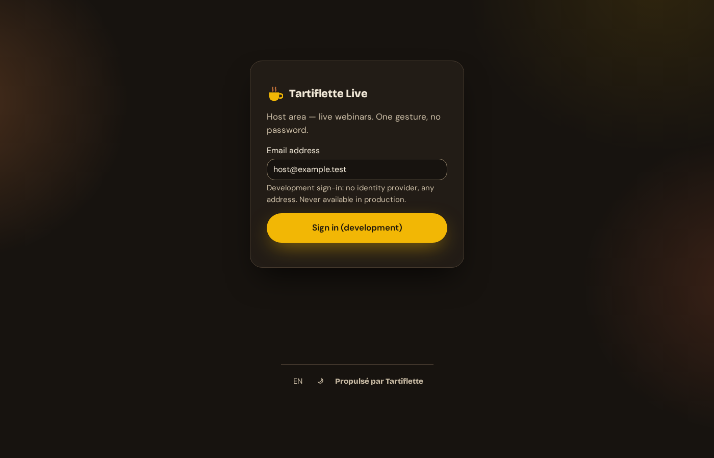
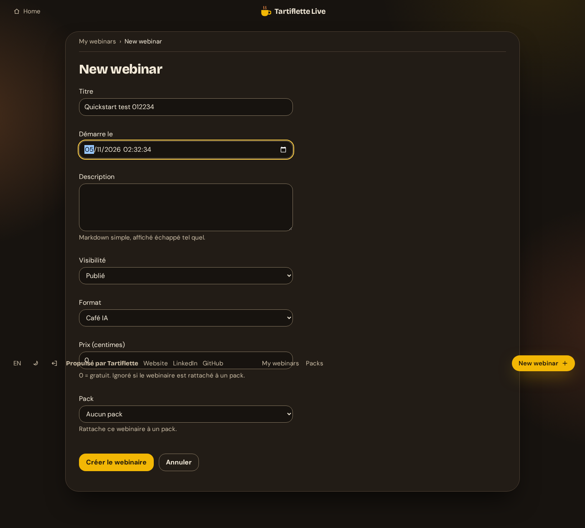
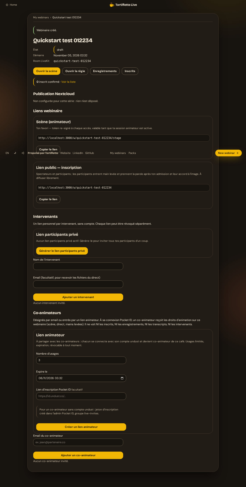
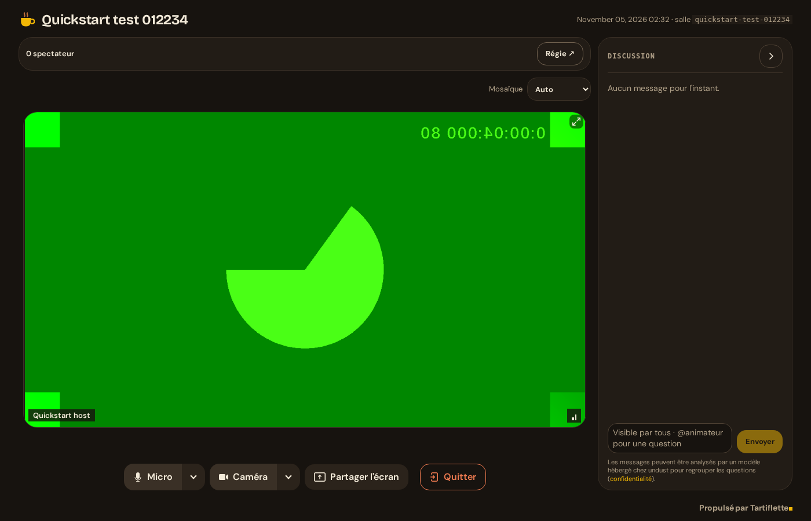
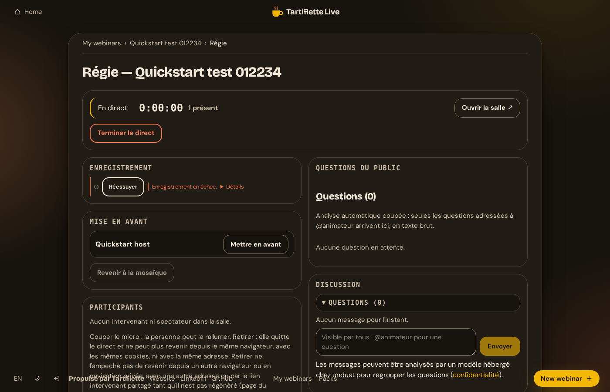
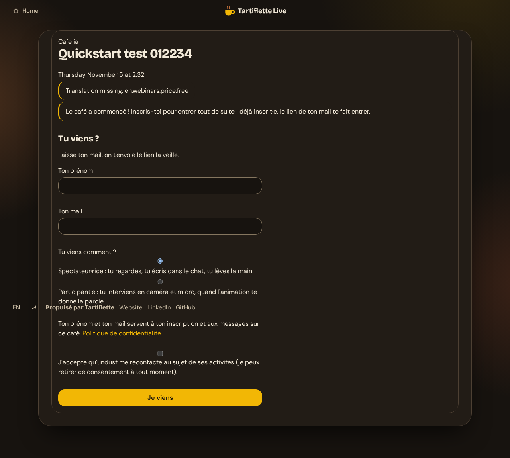
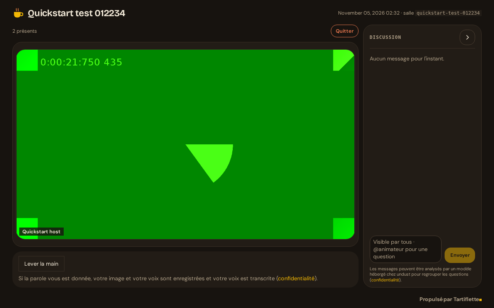

# Quickstart: run a test webinar locally

One command starts the app and LiveKit on your machine. You sign in
as a host without any identity provider, create a webinar, go live, and watch
it as a viewer from a second browser.

This stack is for trying the app. It runs Rails in development mode with a
sign-in that accepts any address, so it only listens on `localhost`: never
expose it on a network. To self-host for real, see
[Production sign-in](#production-sign-in) below and
[examples/livekit/](../examples/livekit/README.md).

## Prerequisites

- Docker Engine 24+ with Docker Compose 2.20+ (or Docker Desktop).
- About 3 GB of disk and 4 GB of RAM for the images and the build.
- Free local ports: 3000 (app), 7880 and 7881 TCP, 7882 UDP (LiveKit).
- A Chromium-based browser or Firefox, with a camera and microphone (or not:
  the stage works without them).

## Start

From the repository root:

```sh
docker compose up
```

The first run builds the app image and pulls LiveKit and Redis (LiveKit uses
Redis to reach the recording egress; the app itself does not): 3 min 22 s
measured from an empty Docker cache on a well-connected 32-core Linux host;
count three to ten minutes depending on your bandwidth and CPU. Later runs
start in seconds. The app is ready when the log shows
`Listening on http://0.0.0.0:3000`.

On first launch, a one-shot `secrets` service generates fresh random values:
the LiveKit API key and secret, the Redis password and the Rails
`secret_key_base`. They live in the `secrets` Docker volume and are reused on
later runs, each file readable only by the service that uses it (mode 0600).
Nothing secret is committed in the repository.

## Sign in

Open <http://localhost:3000/sign_in>. The **Sign in (development)** form
accepts any email address and signs you in as a host with full rights (the
address is prefilled with `host@example.test`). It only answers requests
from this machine: see [Development sign-in](#development-sign-in).



## Create a webinar

1. Go to <http://localhost:3000/webinars/new>.
2. Fill in a title and a start date.
3. Set **Visibilité** to **Publié**: a draft is visible to hosts only, viewers
   get a 404.
4. Click **Créer le webinaire**.



The webinar page lists its links: the stage (host), the speaker invitation
and the public viewer page.



## Join the stage

Open the stage link (`/w/<slug>/stage`). Pick your camera and microphone,
type a display name, then **Rejoindre la salle**.



## Go live

Click **Régie ↗** on the stage to open the control room in a new tab, then
**Démarrer le direct**. Viewers can only enter the room while the webinar is
live.



## Watch as a viewer

Open the public link (`/w/<slug>`) in a second browser, or a private window of
another browser profile, so it does not share the host's session. Register
with a name and any email address: while the webinar is live, access is
immediate (no confirmation email is sent in development).





Both browsers must run on the machine hosting Docker: the media ports are
published on `localhost` only.

## Recording (optional)

The LiveKit egress records the room. Start the stack with it:

```sh
EGRESS_ENABLED=true docker compose --profile egress up
```

Joining the stage starts a composite recording; files land in the
`recordings` volume and are listed under **Enregistrements** on the webinar
page once the recording ends.

## Stop and reset

```sh
docker compose down        # stop, keep data and secrets
docker compose down -v     # stop and delete data, recordings and secrets
```

## Troubleshooting

- **Port already in use**: another service listens on 3000 or 7880-7882. Stop
  it, or change the left side of the `ports` entries in `compose.yaml`.
- **The stage stays on "connecting"**: UDP 7882 is blocked locally; LiveKit
  falls back to TCP 7881 after a few seconds. Check that both ports are free.
- **Viewer page returns 404**: the webinar is still a draft. Edit it and set
  its visibility to published.
- **"Enregistrement en échec" in the control room**: expected without the
  egress, which records the room. Start the stack with the `egress` profile
  (see "Recording") to record.
- **Logs**: `docker compose logs -f app livekit`.

## Production settings

The code carries no value of any real instance. An instance started with
`RAILS_ENV=production` sets its own, and refuses to boot without the first
five:

| Variable | Value |
|---|---|
| `SECRET_KEY_BASE` | Secret signing sessions and cookies, generated once per instance: `openssl rand -hex 64` (the published tree has no encrypted credentials file) |
| `APP_HOST` | Public host name of the app, e.g. `live.example.com`; the app answers this name only (any other `Host` gets a 403, except the `/up` health check) |
| `LIVEKIT_URL` | WebSocket URL of your LiveKit server, e.g. `wss://live.example.com` |
| `BRAND_SUPPORT_EMAIL` | Contact address shown to viewers (withdrawing a consent, questions) |
| `BRAND_ORGANIZATION` | Name of the organization running the instance, the one viewers consent to (French wording: « J'accepte qu'Acme me recontacte ») |
| `LIVEKIT_API_KEY`, `LIVEKIT_API_SECRET` | Key pair of your LiveKit server (see [examples/livekit/.env.example](../examples/livekit/.env.example)); without it no room token is issued and LiveKit webhooks are refused |
| `LIVEKIT_HOST` | LiveKit server API URL, e.g. `https://livekit.example.com` (see [examples/livekit/README.md](../examples/livekit/README.md)) |
| `SMTP_ADDRESS`, `SMTP_PORT`, `SMTP_USERNAME`, `SMTP_PASSWORD` | Outgoing mail server, implicit TLS (port `465` by default); a missing credential fails when a mail is sent |
| `MAIL_FROM` | Sender of the app's emails (default `noreply@<APP_HOST>`) |
| `BRAND_HOST` | Host name shown in emails and pages (default `APP_HOST`) |
| `REGISTRATION_PRIVACY_URL` | HTTPS URL of your privacy policy; viewer registration stays closed without it |
| `BRAND_LEGAL_IDENTITY` | Legal identity of the operator, shown after its name on `/confidentialite` (optional) |
| `BRAND_SERIES_URL` | Public site of the series your webinars belong to: links and signature of the series emails (`+cafe_ia` templates; default: your `/agenda`) |
| `BRAND_SERIES_CO_ORGANIZERS` | Co-organizers who also publish excerpts, named in the on-camera consent (optional; the wording is stored in every consent record) |
| `REGISTRATION_API_ORIGINS` | Optional. Comma-separated origins allowed to post to the cross-origin registration API; unset = API closed ([registrations-api.md](registrations-api.md)) |
| `CHAT_QUESTION_MENTIONS` | Optional. Comma-separated extra chat mentions that turn a message into a question for the host, besides `@animateur`, `@animatrice` and the host's own alias |
| `CRM_SYNC_ENABLED`, `CRM_BASE_URL`, `CRM_API_TOKEN` | Optional. Push of confirmed registrations to your CRM, which implements the HTTP contract of [registrations-api.md](registrations-api.md) |

The `/confidentialite` page shipped with the code is generic: it describes the
data the software processes and names your organization, and says that your
own policy sets purposes, legal bases, recipients and hosting. To serve your
own policy there instead, add `app/views/legal/instance/confidentialite.html.erb`
and, next to it, `confidentialite.yml` with its `version:` and `date:` (as
quoted strings): that version is the one stored with every consent. Either
way, point `REGISTRATION_PRIVACY_URL` to the policy you publish.

## Production sign-in

The development sign-in only exists outside production: an instance started
with `RAILS_ENV=production` refuses to boot if `LIVE_DEV_LOGIN` is set, and
`POST /dev_login` answers 404. In production, hosts sign in with OpenID
Connect, against any compliant provider (Pocket ID, Keycloak, Authentik,
Dex…). Configure the app with:

| Variable | Value |
|---|---|
| `OIDC_ISSUER` | Issuer URL of the provider, e.g. `https://id.example.com` |
| `OIDC_CLIENT_ID` | Client ID registered for the app |
| `OIDC_CLIENT_SECRET` | Client secret |
| `APP_HOST` | Public host name of the app, e.g. `live.example.com` |

There is no default: without these three `OIDC_*` variables the sign-in
button is hidden, and a client ID or secret without an issuer stops the boot.
Register the client with:

- redirect URI `https://<APP_HOST>/auth/pocket_id/callback` (the path keeps
  its historical name whatever the provider);
- the authorization code flow with PKCE (S256), client authentication by
  `client_secret_post`;
- scopes `openid email profile groups`.

Hosts with full rights are the members of the group named by
`LIVE_ANIMATEURS_GROUP` in the `groups` claim, or the verified addresses
listed in `LIVE_PROJECT_HOSTS` (comma-separated). `LIVE_ANIMATEURS_GROUP` has
no default: without it, no group grants these rights. Pick a name of your own,
and make sure group membership can only be set by an administrator of your
provider, never by the users themselves.

## Security notes for self-hosting

- **Tokens in the query string.** Speaker links (`/w/<slug>/join?t=…`), the
  shared speaker invitation (`/i?t=…`), host invitations (`/a?t=…`) and
  registration confirmations (`/confirmer?t=…`) carry their token in the `t`
  parameter; registration links and personal calendar feeds carry it in the
  path (`/r/<token>`, `/agenda/<token>.ics`). The app filters it from its own
  logs, but not your reverse proxy or log collector: configure them to drop
  the query string and to mask `/r/` and `/agenda/` paths, or anyone
  who reads those logs can reuse the links while they are valid. Links already
  sent by mail must keep working, so the format does not change.
- **Opening a speaker link starts the recording.** `GET /w/<slug>/join` notes
  a presence and starts the composite recording of the webinar (unless it has
  ended), on purpose: hosts enter through that link. A link scanner that
  follows a valid speaker link (mail security gateways, chat previews) has
  the same effect. Send speaker links to the people concerned only.
- **Host header.** The app answers `APP_HOST` only. A proxy in front of it must
  forward the original `Host` header.
- **Replay files.** The production image runs Thruster in front of Puma, which
  serves replay videos itself (`X-Sendfile`). The app only trusts that header
  from a loopback peer: behind another proxy, Puma serves the file.

## Development sign-in

The development sign-in opens a host account with full rights from a bare
email address. Three locks keep it local:

1. **Environment.** It exists in development, or in another non-production
   environment with `LIVE_DEV_LOGIN=1` (for example a disposable test
   instance). Never in production: `LIVE_DEV_LOGIN` set there, whatever its
   value, stops the boot.
2. **Origin.** The TCP peer of each request (not the client address derived
   from proxy headers) must be loopback, or in a network listed in
   `LIVE_DEV_LOGIN_ALLOWED_NETWORKS` (comma-separated CIDR). Anything else
   gets a 404 and the form is hidden. A request carrying `X-Forwarded-For`,
   `X-Real-IP`, `Client-IP` or `Forwarded` is only accepted from a loopback
   peer (a local reverse proxy), and only if every forwarded address is
   itself allowed. The quickstart
   lists Docker's private address pools: the app port is published on
   `127.0.0.1` only, and Docker relays your browser from the bridge gateway
   (an address such as `172.18.0.1` or `192.168.208.1`).
3. **Networks.** `LIVE_DEV_LOGIN_ALLOWED_NETWORKS` may only contain loopback
   and private ranges (`10.0.0.0/8`, `172.16.0.0/12`, `192.168.0.0/16`,
   `fc00::/7`); a public range stops the boot.

Accounts created this way carry a reserved identifier prefix (`dev-login|`)
that the OpenID Connect callback refuses, and an address already used by an
OpenID Connect account is refused, whatever its case.
